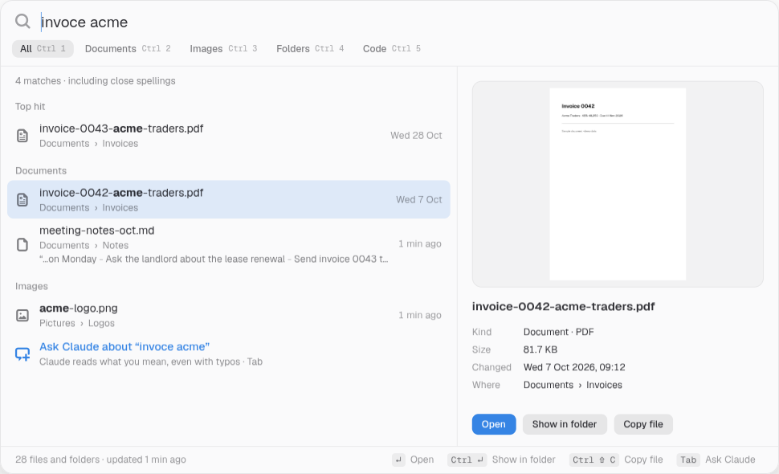
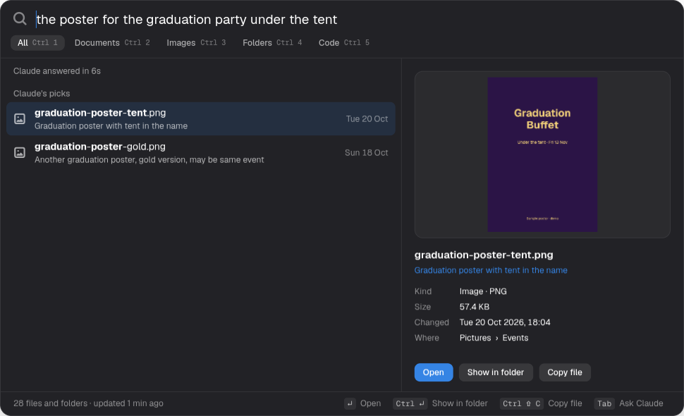

# Find

Press **Super+K** on GNOME and search every file and folder on your computer. Typos are fine. If you'd rather describe what you want ("the poster for the graduation party under the tent"), press **Tab** and Claude reads your question, searches for you and picks the files you mean.





*Screenshots use a demo folder of sample files.*

## What it does

- **Instant search as you type** across file names, folder names and the text inside PDFs, Word files, notes and CSVs. Usually under 20 ms.
- **Typos are fine.** `reciept`, `invoce acme` and `galey` still find the right files, without asking Claude.
- **Ask Claude** with Tab, or just type a sentence and pause. Claude turns it into searches, reads the matches and picks the best ones, each with a one-line reason.
- **Preview** on the right: images, the first page of PDFs, the start of text files, what's inside folders, plus size, date and location.
- **Get the file where it needs to go:** Enter opens it, Ctrl+Enter shows it in its folder, Ctrl+Shift+C copies the file so you can paste it into an email or chat, or drag it straight out of the list.
- **Filters:** All, Documents, Images, Folders, Code (Ctrl+1 to Ctrl+5).
- **Start screen** with the files you opened through Find and the files that changed recently.
- **Opens instantly.** A small background copy keeps Find ready, and the index refreshes itself every 15 minutes.

## Install

Needs GNOME on Wayland or X11, Python 3.10+, GTK 4 and libadwaita.

```sh
# Arch
sudo pacman -S python-gobject gtk4 libadwaita poppler
# Fedora
sudo dnf install python3-gobject gtk4 libadwaita poppler-utils
# Debian / Ubuntu
sudo apt install python3-gi gir1.2-gtk-4.0 gir1.2-adw-1 poppler-utils

git clone https://github.com/manuutechy/find.git ~/.local/src/find
cd ~/.local/src/find
./install.sh
```

The installer sets up the Super+K shortcut, the background copy, the 15-minute index refresh and an app-menu entry. Using another shortcut? `FIND_SHORTCUT='<Super>space' ./install.sh`

### Turn on Ask Claude

Pick one:

- **An Anthropic API key** (fastest, about 6–10 s per question): save just the key in `~/.config/find/api-key` and run `chmod 600 ~/.config/find/api-key`. `ANTHROPIC_API_KEY` in the environment works too.
- **Claude Code** signed in on the same computer: Find uses the `claude` command when there's no key. Slower, about 10–15 s.

Optional: describe your folders in `~/.config/find/context.md` ("Invoices are in ~/Documents/Invoices, my tax papers are in ~/Documents/Personal") so Claude knows your layout. The default model is `claude-opus-5-5`; set `FIND_MODEL` to change it.

## Keys

| Key | Does |
|---|---|
| Super+K | Open or close Find |
| Type | Search instantly |
| Tab | Ask Claude |
| ↑ ↓, Page Up/Down | Move through results |
| Enter | Open |
| Ctrl+Enter | Show in folder |
| Ctrl+C | Copy the path |
| Ctrl+Shift+C | Copy the file itself |
| Ctrl+1 … Ctrl+5 | All, Documents, Images, Folders, Code |
| Esc | Clear the search, then close |

## Privacy

- The index stays on your computer: `~/.local/share/find/index.db` (SQLite).
- Typing searches never leave your computer.
- Only when you ask Claude are these sent to Anthropic: your question, the folder description in `context.md`, and for up to 60 matching files their name, folder, date and up to 120 characters of their text.
- `~/.cache/find/find.log` records Tab presses, answer times and errors. It never records what you type.

## What gets indexed

Everything under your home folder except hidden folders, caches and dependencies (`node_modules`, `vendor`, `.git`, `.venv`, build folders and similar), plus `~/go`, `~/Android` and `~/develop`. Find reads the text of PDFs (first 3 pages), Word files and plain-text files outside code folders. Change `SKIP_NAMES` and `SKIP_PATHS` at the top of `indexer.py` to tune it.

A home folder with about 500,000 items gives a 440 MB index. The first build takes about 30 s and refreshes take about 8 s.

## Uninstall

```sh
./uninstall.sh          # keeps ~/.config/find (your key and notes)
./uninstall.sh --all    # removes those too
```

## How it works

- `indexer.py` walks your home folder into SQLite FTS5: one table for words in names, folders and text, and one 3-letter-piece table for typos. Re-runs only re-read changed files.
- `search.py` ranks matches by text score, where the file lives (Documents above deep code folders), whether your words are in the name itself, how recently it changed and how often you open it. Asking Claude takes two calls: one turns your question into searches, one picks the best of up to 60 matches.
- `app.py` is the GTK 4 / libadwaita window. `--background` keeps a ready-built window so the shortcut shows it in about 0.2 s.

### Testing

`FIND_SHOT=out.png FIND_QUERY="invoice" ./app.py` renders the window to a PNG and exits, without touching the copy running in the background. Add `FIND_AI=1 FIND_WAIT=15000` to include a Claude answer, or `FIND_FILTER=3` to pick a filter. `tools/headless-keys.sh` drives the real app in a private, invisible GNOME session with real key presses.

## License

MIT
